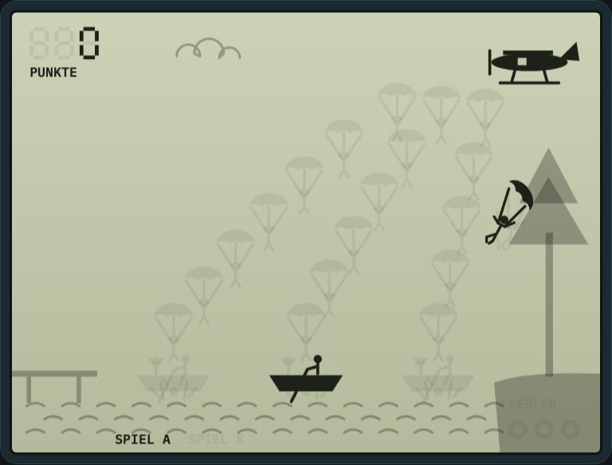

# Seesprung

Ein kleines LCD-Fangspiel im Stil der Taschenspiele um 1980 — eine einzige HTML-Datei, ohne Installation, ohne Server.

Aus dem Wasserflugzeug springen Fallschirmspringer. Du ruderst das Boot nach links und rechts und fängst sie, bevor sie ins Wasser fallen. Manchmal bleibt einer an der Föhre am Ufer hängen, strampelt eine Weile und reißt sich dann los — dann kommt er später unten an als gedacht.

## Spielen

- **Herunterladen:** [`seesprung.html`](https://github.com/madmarc2000/seesprung/releases/latest/download/seesprung.html) speichern und im Browser öffnen. Läuft am Handy, Tablet und Rechner.
- **Steuerung:** Knöpfe LINKS/RECHTS, Tippen auf die linke/rechte Hälfte des Bildschirms oder Pfeiltasten (A/D). Leertaste oder P pausiert.
- **Spiel A** ist ruhiger, **Spiel B** schneller und mit mehr Springern gleichzeitig.
- Drei Fehler, dann ist das Spiel vorbei. Bei 200 und 500 Punkten werden die Fehler gelöscht.
- Der Rekord bleibt im Browser gespeichert (localStorage), der Ton ist ein kleiner Piepser über Web Audio.

## Technik

- Reines HTML, CSS und JavaScript in einer Datei, gezeichnet auf ein `<canvas>` (400 × 300, skaliert).
- Jede mögliche Figur-Position ist schwach im Hintergrund sichtbar, wie die Segmente eines echten LCD.
- Einzige externe Abhängigkeit sind zwei Google-Schriften; ohne Netz fällt die Seite auf Systemschriften zurück.

## Lizenz

MIT — siehe [LICENSE](LICENSE). Motiv, Grafik und Code sind eigene Arbeit.
